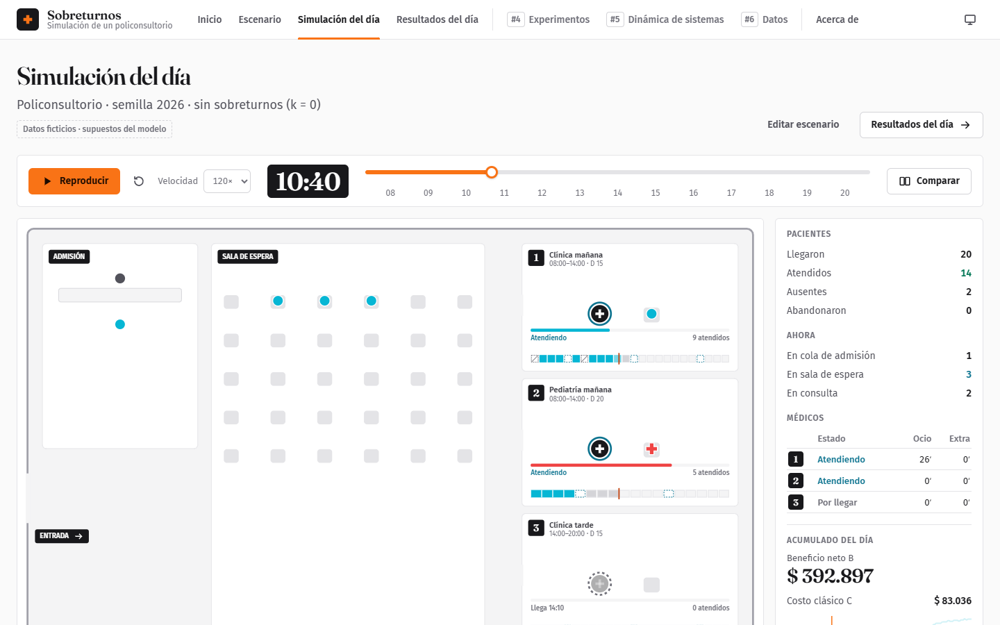
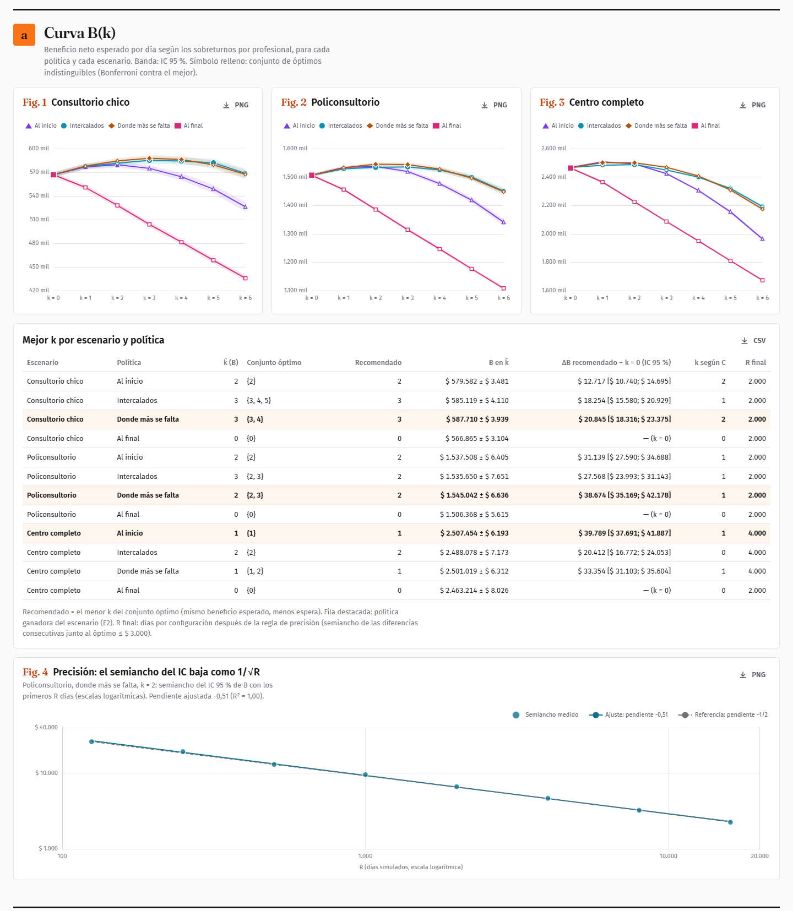
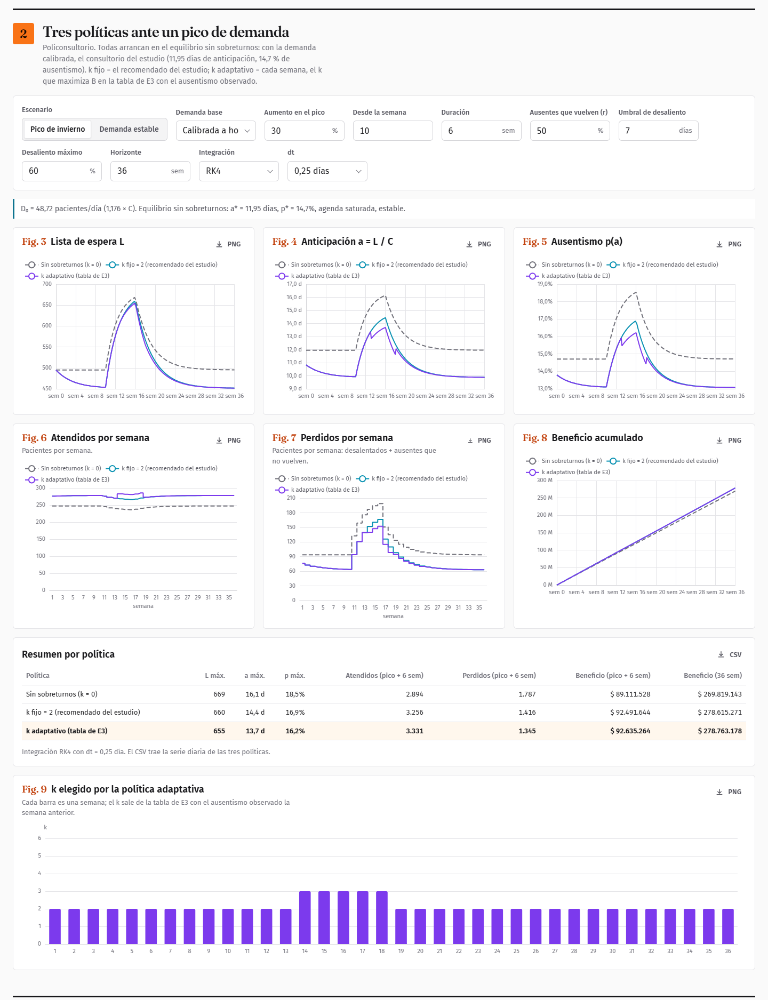
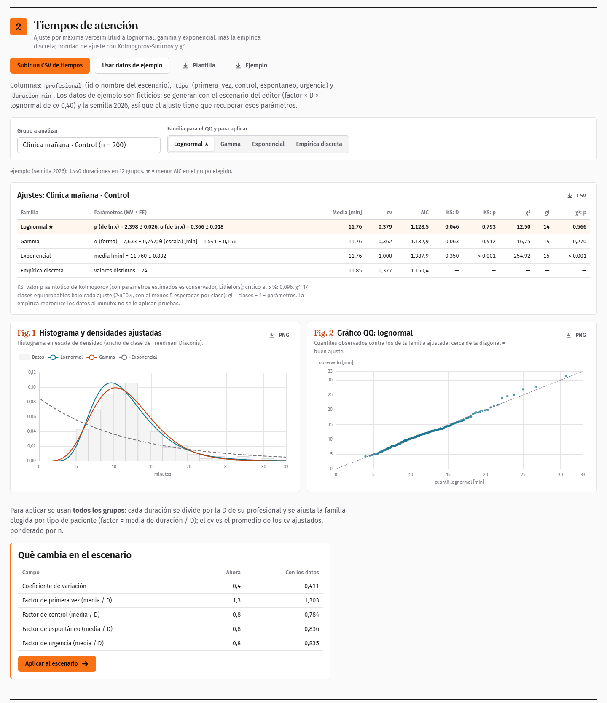

# Sobreturnos · simulación de un policonsultorio

> **In English:** *Sobreturnos* is a browser-based discrete-event simulation of an outpatient
> clinic that answers a daily scheduling question: **how many overbookings should each doctor
> take, and where in the schedule should they go**, given that about one in seven patients does
> not show up. It runs entirely client-side (TypeScript, React, Web Workers), is reproducible from
> a seed, validates its engine against queueing theory, picks the best policy with Monte Carlo
> experiments and paired comparisons, and adds a system-dynamics model of the waiting list.
> Live demo: **https://tomas-romero.github.io/simulacion_consultorio/**

**Demo:** https://tomas-romero.github.io/simulacion_consultorio/

En la agenda de un consultorio, uno de cada siete pacientes no viene. Sobrerreservar
(**sobreturnos**) recupera esas horas, pero cuando vienen todos la sala se llena y el médico
termina en horas extra. Esta aplicación simula el día minuto a minuto y busca **cuántos
sobreturnos dar y dónde ubicarlos** para maximizar el beneficio neto esperado:

```
B = ingresos − c_espera·espera − c_extra·horas extra − c_perdido·pacientes perdidos
```

Proyecto integrador de **Simulación** (UTN, Facultad Regional San Rafael, 2026).



## Qué se puede hacer

| Pantalla | Qué muestra |
|---|---|
| **Escenario** | Editor validado campo por campo: profesionales, agenda, ausentismo (curva logística), demanda espontánea, admisión y costos. Tres escenarios de ejemplo. |
| **Simulación del día** | La planta animada a partir de la traza del modelo: pacientes que llegan, esperan, faltan o abandonan; comparación sincronizada con y sin sobreturnos, misma semilla. |
| **Resultados del día** | Agenda real de cada profesional (Gantt), sala de espera en el tiempo, espera por clase, desglose de B y del costo clásico C. |
| **Experimentos** | Estudio Monte Carlo precalculado (E1–E6): curva B(k), políticas, sensibilidad a los costos y al ausentismo, regla práctica y riesgo; y un laboratorio que corre experimentos a medida en el navegador. |
| **Dinámica de sistemas** | La lista de espera semana a semana: diagrama causal y de Forrester, tres políticas ante un pico de demanda, sensibilidad a los supuestos, modelo fluido del día contra eventos discretos y convergencia Euler/RK4. |
| **Datos** | Importar y exportar el escenario en JSON, ajustar tiempos de atención medidos (lognormal, gamma, exponencial, empírica; KS y χ²), estimar el ausentismo por regresión logística y aplicarlo al escenario; reporte imprimible. |

| | |
|---|---|
|  |  |
|  |  |

Más capturas, en claro y en oscuro, en [`docs/capturas/`](docs/capturas/LEEME.md).

## Qué responde

Con los tres escenarios de ejemplo (datos ficticios, marcados como supuestos) y entre 2.000 y 4.000 días
simulados por configuración (la regla de precisión duplicó R en el centro). Las cifras son de la serie de la política
ganadora, con los mismos días para k = 0 y para el k recomendado; la ganancia es la diferencia pareada día a día:

| Escenario | Política ganadora | Sobreturnos por profesional | B por día (IC 95 %) | Sin sobreturnos | Ganancia por día (IC 95 %) | Días |
|---|---|---|---|---|---|---|
| Consultorio chico (1 médico) | donde más se falta | 3 | $ 587.710 ± 3.939 | $ 566.865 | +$ 20.845 [$ 18.316; $ 23.375] | 2.000 |
| Policonsultorio (3 profesionales) | donde más se falta | 2 | $ 1.545.042 ± 6.636 | $ 1.506.368 | +$ 38.674 [$ 35.169; $ 42.178] | 2.000 |
| Centro completo (6 profesionales) | al inicio del turno | 1 | $ 2.507.454 ± 6.193 | $ 2.467.665 | +$ 39.789 [$ 37.691; $ 41.887] | 4.000 |

- No hay una regla universal: reponer exactamente a los que se espera que falten
  (k = p̄·N̄) acierta donde los cupos cubren la demanda espontánea y falla en el centro. La
  corrección por espontáneos no generaliza con validación dejando un escenario afuera: **hay que
  simular cada consultorio**.
- Por qué gana cada política: la apertura de cada turno tiene un ocio estructural; con un
  sobreturno conviene llenarlo al inicio, con dos el segundo ya forma cola y conviene repartirlos.
- A escala de semanas, dar sobreturnos acorta la lista de espera y baja el ausentismo; ajustar k
  cada semana al ausentismo observado nunca pierde contra el k fijo, pero gana poco.

## Cómo se valida

- **Motor contra teoría de colas** (`npm run validar`): M/M/1 y M/M/3 contra Erlang C, con IC
  simultáneo al 95 % (Bonferroni). Ejemplo M/M/3, ρ = 0,833: Wq teórico 21,07 min, simulado
  21,49 [20,72; 22,27]. Ley de Little en cada réplica con error < 0,12 %.
- **Modelo del consultorio** (`npm run validar-modelo`): M/G/1 contra Pollaczek-Khinchine
  (Wq 16,24 teórico, 16,38 [15,76; 17,00] simulado) y una red admisión M/M/1 → consultorios M/M/3
  contra Jackson/Burke (espera total 16,28 teórica, 16,20 [15,70; 16,70]).
- **Casos deterministas y límite**: sin aleatoriedad la espera, el ocio y las horas extra son
  exactamente 0; conservación de pacientes; 100 % de ausentismo; 1 y 6 profesionales.
- **Experimentos reproducibles**: el estudio da el mismo resultado bit a bit con cualquier
  cantidad de hilos; en el navegador (Web Workers) coinciden las 71 decisiones del estudio de
  Node.
- **Dinámica de sistemas**: equilibrio analítico contra simulado (diferencia < 10⁻⁸),
  conservación de pacientes (< 10⁻⁷) y convergencia de Euler (orden 1) y RK4.
- **Ajuste de datos**: KS, χ², máxima verosimilitud y regresión logística contrastados con scipy.
- **220 tests** con Vitest (`npm test`).

## Temas de la materia aplicados

- Generación de números pseudoaleatorios (xoshiro128\*\*, flujos independientes por fuente) y
  números aleatorios comunes.
- Generación de variables aleatorias por transformada inversa: exponencial, lognormal,
  triangular, normal truncada, discreta empírica.
- Simulación de eventos discretos: calendario de eventos, recursos y colas con prioridades.
- Teoría de colas: M/M/c, Erlang C, Ley de Little, Pollaczek-Khinchine, redes de Jackson.
- Simulación Monte Carlo: réplicas, intervalos de confianza, comparaciones pareadas,
  Bonferroni, regla de precisión, calentamiento (Welch).
- Verificación y validación de modelos, calibración y análisis de sensibilidad.
- Dinámica de sistemas: diagrama causal, Forrester, equilibrio y estabilidad, Euler y RK4.
- Ajuste de distribuciones (máxima verosimilitud, Kolmogorov-Smirnov, χ²) y regresión logística.

## Arquitectura

Todo corre en el navegador, sin backend. Las corridas pesadas van en Web Workers.

```
src/
  motor/         motor de eventos discretos en TS puro (sin DOM): PRNG, distribuciones,
                 calendario, recursos, estadística, teoría de colas
  modelo/        el policonsultorio: escenario (zod), agenda, simulación de un día, métricas, traza
  experimentos/  Monte Carlo: tareas por bloque, pool de workers, análisis, estudio E1–E6
  dinamica/      modelo fluido del día y lista de espera (Euler/RK4, equilibrio, sensibilidad)
  datos/         ajuste de distribuciones, KS, χ², regresión logística, CSV
  ui/            React: pantallas, animación (canvas) a partir de la traza, gráficos (ECharts)
tests/           Vitest
docs/            modelo conceptual, calibración, experimentos, dinámica de sistemas, diseño
public/resultados/  estudio y análisis precalculados (se regeneran con scripts)
```

- La animación **reproduce la traza** del modelo: nunca vuelve a simular.
- Toda aleatoriedad sale de `FabricaFlujos(semilla, réplica).flujo('nombre')`: con la misma
  semilla, el mismo día.
- Documentación: [modelo conceptual](docs/modelo-conceptual.md) ·
  [calibración](docs/calibracion.md) · [experimentos](docs/experimentos.md) ·
  [dinámica de sistemas](docs/dinamica-sistemas.md) · [diseño](docs/diseno-ui.md).

## Cómo correrlo

Requiere Node 22.

```bash
npm install
npm run dev          # http://localhost:5173
npm test             # suite completa
npm run build        # typecheck + build de producción en dist/
```

Otros comandos: `npm run validar`, `npm run validar-modelo`, `npm run estudio` (estudio Monte
Carlo completo, ~2 min con 8 hilos), `npm run complementos`, `npm run dinamica` y `npm run informe` (informe final y guion de la defensa en .docx, con Python y
python-docx; no se publican). La lista completa
está en [`CLAUDE.md`](CLAUDE.md).

Cada push a `main` corre los tests y publica el sitio en GitHub Pages
([`.github/workflows/pages.yml`](.github/workflows/pages.yml)).

## Tecnología

TypeScript (strict), React 19, Vite, ECharts, zod, Vitest. Sin librerías de simulación ni de
estadística: el motor, las distribuciones y las pruebas están implementados en el proyecto.

## Autoría

**Tomás Romero** · Simulación, UTN Facultad Regional San Rafael, 2026.
Diseño y desarrollo: **TARC Tech**.

Desarrollado con asistencia de Claude Code bajo dirección y revisión del autor.
