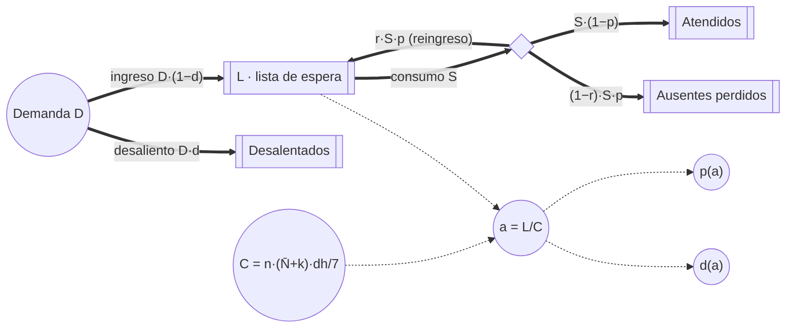

# Dinámica de sistemas (paso #5, Cap. 7)

> Diseño escrito antes de implementar. Código en `src/dinamica/` (TypeScript puro); pantalla en
> `#/dinamica`. El modelo del día, los presets y el estudio precalculado no se modifican: este
> módulo los usa como datos.

Hay dos modelos:

- **Parte A · Modelo fluido de la jornada** (minutos): la sala de espera como stock continuo. Sirve
  para contrastar el enfoque determinista del Cap. 7 con la simulación de eventos discretos del
  Cap. 3.
- **Parte B · Lista de espera** (semanas): el modelo principal. Describe cómo se forman la
  anticipación de los turnos y el ausentismo, y cómo responden a un pico de demanda con tres
  políticas de sobreturnos.

---

## Parte A · Modelo fluido de la jornada

Hay un stock por profesional, W_i(t), los pacientes esperando en la sala. La sala total es
W(t) = Σ W_i.

```
dW_i/dt = λ_i(t) − s_i(t)
s_i(t)  = μ_i(t)                 si W_i > 0
s_i(t)  = min(λ_i(t), μ_i(t))    si W_i = 0
```

**Entrada λ_i(t)** [pac/min]: los pacientes que pasan a la sala, con los mismos parámetros medios
que el modelo del día.

- **Turnos:** cada slot para turnos (no cupo) aporta (1 − p̄)·ocupación de paciente. Su hora de
  llegada a la sala es hora + desvío + admisión. Las distribuciones del desvío y del tiempo de
  admisión se representan por 200 y 20 cuantiles.
- **Sobreturnos:** 1 − p(1 día), en la ubicación esperada de su política. El fluido no puede
  representar `mayor_ausentismo`, que depende de la anticipación sorteada de cada slot, y lo trata
  como intercalado.
- **Espontáneos:** tasa por hora × peso de la especialidad, repartida entre los profesionales de
  la especialidad que admiten a esa hora. Los demás se pierden en la puerta, igual que en el modelo
  del día.

**Capacidad μ_i** [pac/min] = 1 / duración media de la consulta, ponderada entre turnos (0,925·D) y
espontáneos (0,8·D). Rige desde la llegada media del médico, inicio + E[demora] = inicio + 8,3 min,
y sigue después del fin del turno mientras haya stock.

**Integración:** Euler con dt = 0,25 min. Se compara contra la media de 500 días simulados con la
misma semilla del estudio (2026600), en el policonsultorio con política intercalada.

### Resultado

Eventos discretos con su IC 95 %:

| | Área en sala, fluido [pac·min/día] | Área en sala, eventos discretos | Espera por paciente, fluido [min] | Espera por paciente, eventos discretos | Máximo en sala, fluido | Máximo en sala, eventos discretos |
|---|---|---|---|---|---|---|
| k = 0 | 209,1 | 783,4 ± 28,0 | 3,41 | 12,63 ± 0,41 | 2,02 | 4,35 |
| k = 2 | 571,9 | 1231,4 ± 41,3 | 8,55 | 18,25 ± 0,57 | 2,16 | 5,71 |

El modelo fluido **subestima la espera 3,7 veces sin sobreturnos y 2,1 veces con k = 2**.

- Fuera de la apertura de cada turno predice cola cero, porque la capacidad media supera a la
  entrada media.
- En la simulación, la variabilidad de los tiempos de atención, la puntualidad y la demanda
  espontánea genera cola aunque la capacidad alcance (teoría de colas: la espera crece con la
  varianza, Pollaczek-Khinchine).
- Por eso las decisiones de sobreturnos no se pueden tomar con un modelo de medias: el costo de
  espera que equilibra al ocio aparece solo con la variabilidad.

---

## Parte B · Dinámica de sistemas de la lista de espera

### B.1 Diagrama causal

```mermaid
flowchart LR
  L([Lista de espera L]) -- "+" --> A[Anticipación a = L/C]
  C[Capacidad C] -- "−" --> A
  A -- "+" --> P[Ausentismo p]
  P -- "+" --> RE[Reingresos r·p·S]
  RE -- "+" --> L
  A -- "+" --> DS[Desaliento d]
  DS -- "−" --> DE[Demanda efectiva D·(1−d)]
  DE -- "+" --> L
  L -- "+" --> S[Consumo de turnos S]
  S -- "−" --> L
  K[Sobreturnos k] -- "+" --> C
  P -. "observado (semanal)" .-> K
```

**Bucles:**

- **R1 · Ausentismo que se realimenta (refuerzo):** L↑ → a↑ → p↑ → reingresos↑ → L↑. Cuanto más
  lejos queda el turno, más pacientes faltan; la mitad de ellos vuelve a pedir turno y alarga la
  lista.
- **B1 · Desaliento (balance):** L↑ → a↑ → desaliento↑ → demanda efectiva↓ → L↓. Cuando la espera
  supera un umbral, parte de los pacientes se atiende en otro lado.
- **B2 · Consumo (balance):** L↑ → S↑ (hasta la capacidad) → L↓.
- **B3 · Política adaptativa (balance, solo con k adaptativo):** p observado↑ → k↑ → C↑ → a↓ → p↓.

### B.2 Diagrama de Forrester



En la pantalla los dos diagramas están dibujados en SVG.

### B.3 Ecuaciones

El tiempo t está en días calendario. Los stocks y flujos se miden en pacientes y pacientes/día.

| Variable | Ecuación | Unidad |
|---|---|---|
| Capacidad | C(k) = n · (N̄ + k) · dh / 7 | turnos/día |
| Anticipación | a = L / C | días |
| Ausentismo | p̄(a) = Σ f_d · logist(β₀ + β₁ · d · a / ā) / Σ f_d, con ā la media de la tabla | — |
| Desaliento | d(a) = d_max · clamp((a − u) / w, 0, 1) | — |
| Demanda | D(t) = D₀ · (1 + 0,3 · 1{semana ∈ pico}) | pac/día |
| Consumo | S = min(C, L / τ) | turnos/día |
| Lista | dL/dt = D·(1 − d) + r·p·S − S | pac/día |
| Atendidos | dA/dt = S·(1 − p) | pac/día |
| Ausentes perdidos | dN/dt = (1 − r)·p·S | pac/día |
| Desalentados | dZ/dt = D·d | pac/día |
| Beneficio | dB/dt = B_E3(k, p) · (dh/7) · (S/C) | $/día |
| k adaptativo | al cierre de cada semana, k = argmax_k B_E3(k, p_observado), con p_observado = ausentes / consumo de esa semana | — |

**Conservación:** L + A + N + Z = L₀ + ∫D dt. Los reingresos vuelven a L y no se crean ni se pierden
pacientes.

**Equilibrio** con demanda constante D: dL/dt = 0, o sea g(a*) = 0 con
g(a) = D·(1 − d(a)) − min(C, a·C/τ)·(1 − r·p̄(a)), y L* = a*·C.

- No tiene forma cerrada en a (por la logística). `equilibrios()` recorre a ∈ (0, 365] con paso 0,01
  y refina cada cambio de signo por bisección.
- **Estabilidad:** un equilibrio es estable si g'(a*) < 0 (si la lista crece un poco, se achica).
  Entre τ y u no hay desaliento y g(a) = D − C·(1 − r·p̄(a)) **crece** con a: solo actúa R1. Por eso,
  **todo equilibrio saturado con a* < u es inestable**. Con un tramo así el sistema puede ser
  biestable: una lista casi vacía (a < τ) y otra larga, frenada por el desaliento (a > u).
- En cambio, la ecuación es lineal en D: dada una anticipación objetivo, D se despeja exacta
  (`demandaCalibrada()`).

**Acople micro → macro:** B_E3(k, p) es el beneficio medio por día hábil del estudio precalculado
(E3: policonsultorio, política ganadora `mayor_ausentismo`, k = 0–6, ausentismo 5–30 %),
interpolado linealmente en p y recortado a [5 %, 30 %]. Es una tabla de consulta: no se vuelve a
simular el día.

### B.4 Parámetros

| Parámetro | Valor | Origen |
|---|---|---|
| n, profesionales | 3 | Preset policonsultorio |
| N̄, turnos reservables por profesional y día hábil | 19,33 | Preset: slots sin cupos × ocupación 1 |
| dh, días hábiles por semana | 5 | Supuesto SD1 |
| C(0), capacidad sin sobreturnos | 41,43 turnos/día | n·N̄·dh/7 |
| D₀, demanda base | 48,72 pac/día = 1,176·C(0) | Calibrada (SD3): equilibrio con k = 0 en a* = 11,95 días |
| Pico | +30 % entre las semanas 10 y 16 | Mensaje #5 (invierno) |
| r, reingreso de ausentes | 0,5 | Supuesto SD4 |
| Desaliento: umbral u, ancho w, máximo d_max | 7 d, 14 d, 0,6 | Supuesto SD5 (u pasó de 14 a 7 días en el #6) |
| τ, tiempo mínimo hasta el turno | 1 día | Supuesto SD6; mínimo de la tabla |
| β₀, β₁ y tabla de anticipación | −2,4973; 0,055; 1, 3, 7, 14, 21, 30 días | Modelo del día |
| Horizonte | 36 semanas | — |

### B.5 Supuestos

- **SD1.** El consultorio atiende 5 días por semana. La capacidad por día calendario es la de un
  día hábil × 5/7.
- **SD2.** La anticipación media es L/C (Ley de Little: tiempo en el sistema = stock / tasa de
  salida).
- **SD3.** El consultorio de hoy es el del estudio: sin sobreturnos, la lista está en equilibrio
  con la anticipación media de la tabla del modelo del día (11,95 días, p̄ = 14,7 %). D₀ se calibra
  para que así sea (B.6). Hasta el #5 era D₀ = C(0), que daba a* = 16,2 días y p* = 18,6 %: otro
  consultorio que el del estudio.
- **SD4.** La mitad de los ausentes vuelve a pedir turno; la otra mitad se pierde.
- **SD5.** El desaliento crece linealmente desde 0, con 7 días de anticipación, hasta el 60 % de la
  demanda, con 21 días. El umbral tiene que quedar por debajo de la anticipación de hoy: si no, el
  equilibrio calibrado es inestable (B.3 y B.6). Una semana es el único de los umbrales de la
  sensibilidad (7, 14 y 21 días) que cumple esa condición.
- **SD6.** Nadie consigue turno antes de un día.
- **SD7.** El ausentismo con anticipación media a usa la misma logística del modelo del día sobre la
  tabla de anticipación reescalada a media a.
  - Con a = 11,95 días, la media de la tabla, reproduce el p̄ = 14,7 % del modelo del día.
  - Usar la logística en a directamente subestimaría p̄ por la desigualdad de Jensen
    (p(11,95) = 13,3 %).
- **SD8.** Todas las políticas arrancan del mismo estado, el consultorio de hoy (a = 11,95 días con
  k = 0), y desde t = 0 aplican su k.
- **SD9.** El beneficio diario es el de la tabla de E3 escalado por la fracción de la agenda que se
  usa (S/C). La tabla supone agenda llena; con lista corta, S < C (ver B.11).
- **SD10.** Los sobreturnos suman capacidad de la lista igual que un turno. En el modelo del día se
  reservan con un día de anticipación; acá no se distingue.

### B.6 Calibración de D₀ (#6)

Con la ecuación de equilibrio despejada en D para a* = ā = 11,95 días y k = 0:

D₀ = C(0)·(1 − r·p̄(ā)) / (1 − d(ā)) = 41,43 · (1 − 0,5·0,14705) / (1 − 0,2121) = **48,72 pac/día
(1,176·C(0))**.

| k | C [turnos/día] | a* [días] | L* | p* | d* | Estado |
|---|---|---|---|---|---|---|
| 0 | 41,43 | 11,950 | 495,07 | 14,71 % | 21,21 % | Saturado (S = C), estable (g' = −1,92), único |
| 1 | 43,57 | 10,911 | 475,42 | 13,86 % | 16,76 % | Saturado, estable |
| 2 | 45,71 | 9,869 | 451,13 | 13,06 % | 12,29 % | Saturado, estable |
| 3 | 47,86 | 8,823 | 422,22 | 12,31 % | 7,81 % | Saturado, estable |

- **Saturado:** la demanda potencial supera la capacidad en un 17,6 %; el desaliento (21 % con 12
  días de espera) y el consumo la equilibran. Es la situación típica de una lista de espera
  pública: la agenda está llena y la anticipación la fija la gente que se cansa de esperar.
- **Por qué cambió u:** con u = 14 días, el D₀ que pone el equilibrio en 11,95 días es
  C(0)·(1 − r·p̄) = 0,926·C(0), y hay **tres** equilibrios: a = 0,97 días (estable, lista casi
  vacía), a = 11,95 días (**inestable**, g' = +0,17) y a = 14,25 días (estable). El consultorio de
  hoy quedaría sobre un filo: cualquier perturbación lo lleva a uno de los otros dos, y un pico lo
  dejaría en la lista larga aunque después la demanda vuelva a la normal (histéresis). Un estado
  observado y estacionario tiene que ser un equilibrio estable, así que el umbral pasa a 7 días
  (SD5).
- Con u = 7, el equilibrio de cada k es único y estable, y los sobreturnos lo mueven de forma
  continua (cada sobreturno por profesional acorta la anticipación ~1 día).

### B.7 Validación (tests en `tests/dinamica/lista.test.ts` y `calibracion.test.ts`)

| Validación | Resultado |
|---|---|
| Ausentismo con a = ā | p̄(11,95) = 14,705 %, el del modelo del día |
| Calibración | Con D₀ calibrado, `equilibrio()` devuelve a* = 11,95 días (error < 10⁻⁸) y g(a*) = 0 |
| Estabilidad | Equilibrio único y estable; la integración vuelve a él desde 0,5·L* y 1,5·L* |
| Biestabilidad con u = 14 | Tres equilibrios (estable, inestable en 11,95, estable), con el signo de g' esperado |
| Convergencia al equilibrio | Desde 0,3·L* y 2·L* (RK4, dt = 0,25, 120 semanas): diferencia < 10⁻⁴ |
| Consistencia | a* = 11,95 días, dentro del rango de la tabla del modelo del día (1–30 días) |
| Conservación | Error < 10⁻⁷ pacientes, con Euler y RK4 y las tres políticas |
| Monotonía | Más demanda → L* mayor y L(t) mayor en toda la trayectoria (D × 0,95; 1; 1,05; 1,1) |

### B.8 Convergencia numérica

Escenario con pico, k = 2 fijo. Referencia: RK4 con dt = 0,01 (L máx. = 660,619; L final = 451,729;
beneficio $278.615.273).

| Método | dt [días] | L máx. | Error L máx. | L final | Error L final | Error beneficio |
|---|---|---|---|---|---|---|
| Euler | 1 | 662,082 | 1,46 | 451,662 | 0,067 | $3.507 |
| Euler | 0,25 | 660,994 | 0,375 | 451,712 | 0,017 | $859 |
| Euler | 0,1 | 660,778 | 0,159 | 451,722 | 0,0068 | $342 |
| RK4 | 1 | 659,563 | 1,06 | 451,725 | 0,0041 | $10 |
| RK4 | 0,25 | 660,272 | 0,347 | 451,728 | 0,0010 | $2 |
| RK4 | 0,1 | 660,489 | 0,130 | 451,728 | 0,00038 | $1 |

- **Euler:** el error es proporcional a dt (orden 1): dividir dt por 4 divide el error por ~4.
- **RK4:** es ~17 veces más preciso en L final y ~350 veces en el beneficio. En L máx. su ventaja es
  chica, porque el modelo no es suave: `min(C, L/τ)`, la rampa del desaliento y el escalón del pico
  tienen quiebres, y en ellos RK4 pierde su orden 4. Es una limitación conocida de los métodos de
  orden alto con funciones definidas por tramos.
- Con dt = 0,25 los dos métodos quedan por debajo de medio paciente sobre una lista de ~660, de
  sobra para el análisis. La pantalla usa RK4 con dt = 0,25 por defecto.

### B.9 Resultados: tres políticas durante el pico

Pico de +30 % entre las semanas 10 y 16. Los totales "pico" van de la semana 10 a la 22 (el pico y
las 6 semanas siguientes). RK4, dt = 0,25. Todas arrancan en el consultorio de hoy (L = 495,1).
Se regeneran con `npm run dinamica` (`public/resultados/dinamica.json` y CSV).

| Política | L máx. | a máx. [días] | p máx. | Atendidos (pico) | Perdidos (pico) | Beneficio (pico) | Beneficio (36 sem) | Perdidos (36 sem) |
|---|---|---|---|---|---|---|---|---|
| Sin sobreturnos (k = 0) | 669,0 | 16,15 | 18,54 % | 2894 | 1787 | $89.111.528 | $269.819.143 | 4064 |
| k fijo = 2 (recomendado del estudio) | 660,3 | 14,44 | 16,90 % | 3256 | 1416 | $92.491.644 | $278.615.271 | 3015 |
| k adaptativo (tabla de E3) | 655,3 | 13,69 | 16,22 % | 3331 | 1345 | $92.635.264 | $278.763.178 | 2939 |

**Política adaptativa:**

- **k semana a semana:** 2 2 2 2 2 2 2 2 2 2 2 2 2 3 3 3 3 3 2 2 2 2 2 2 2 2 2 2 2 2 2 2 2 2 2 2.
- **Comportamiento:** con el ausentismo de hoy (14,7 %) elige k = 2, igual que el estudio. Sube a 3
  entre las semanas 14 y 18, cuando el pico lleva el ausentismo observado arriba del 15,2 % (el
  umbral de la tabla de E3 entre k = 2 y k = 3), y vuelve a 2 cuando la lista se descomprime.
- **Frente a k fijo = 2:** pierde 71 pacientes menos durante el pico (1345 contra 1416, −5 %) y gana
  $143.620 más en el pico ($147.907 en 36 semanas, +0,05 %).
- **Frente a k = 0:** pierde 442 pacientes menos en el pico (−25 %) y gana $8,9 millones más en 36
  semanas (+3,3 %).
- **Comparación con el #5 (D₀ = C(0)):** con el consultorio calibrado la lista de hoy es más corta
  (495 contra 670) y el ausentismo de partida es el del estudio; por eso **k = 2 ya es lo que pide
  la tabla** y el adaptativo solo se separa del fijo durante el pico. Su ventaja en beneficio cae
  de $2,1 millones a $0,15 millones en 36 semanas. Los sobreturnos en sí (k = 2 contra k = 0)
  siguen valiendo $8,8 millones.
- **Mecanismo:** dar sobreturnos acorta la lista, lo que baja la anticipación, el ausentismo y el
  desaliento (los bucles R1 y B1 trabajan a favor). Ajustar k al ausentismo observado agrega el
  bucle B3, que responde al pico.

### B.10 Sensibilidad a los supuestos sin dato (#6)

De a un parámetro por vez, con los demás en su valor base (en negrita). El consultorio de hoy es un
dato: en cada variante se recalibra D₀ para que el estado sin sobreturnos siga en a = 11,95 días, y
las tres políticas arrancan de él. Horizonte de 36 semanas. Δ = adaptativo − k fijo (= 2).

| Parámetro | Valor | D₀/C(0) | ¿Hoy es estable? | B k = 0 | B k fijo | B adaptativo | ΔB | Perdidos k = 0 / fijo / adapt. | ΔP | Gana en B | Gana en perdidos |
|---|---|---|---|---|---|---|---|---|---|---|---|
| r | 0,25 | 1,223 | Sí | $269.881.899 | $278.596.137 | $278.739.108 | +$142.971 | 4572 / 3525 / 3450 | −75 | Adaptativo | Adaptativo |
| r | **0,5** | 1,176 | Sí | $269.819.143 | $278.615.271 | $278.763.178 | +$147.907 | 4064 / 3015 / 2939 | −76 | Adaptativo | Adaptativo |
| r | 0,75 | 1,129 | Sí (2 equilibrios) | $269.743.877 | $278.637.285 | $278.790.318 | +$153.033 | 3557 / 2505 / 2429 | −76 | Adaptativo | Adaptativo |
| d_max | 0,3 | 1,036 | Sí (2 equilibrios) | $267.475.536 | $279.079.828 | $279.313.226 | +$233.398 | 2643 / 1522 / 1451 | −71 | Adaptativo | Adaptativo |
| d_max | **0,6** | 1,176 | Sí | = base | | | +$147.907 | | −76 | Adaptativo | Adaptativo |
| d_max | 0,9 | 1,359 | Sí | $270.464.085 | $278.432.729 | $278.517.398 | +$84.669 | 6033 / 5013 / 4943 | −70 | Adaptativo | Adaptativo |
| u | **7 d** | 1,176 | Sí | = base | | | +$147.907 | | −76 | Adaptativo | Adaptativo |
| u | 14 d | 0,926 | **No** (3 equilibrios) | $266.948.493 | $272.765.990 | $278.523.970 | +$5.757.979 | 1397 / 572 / 597 | +25 | Adaptativo | **k fijo** |
| u | 21 d | 0,926 | **No** (3 equilibrios) | $257.967.687 | $272.765.990 | $278.523.970 | +$5.757.979 | 1546 / 572 / 597 | +25 | Adaptativo | **k fijo** |
| Pico | +15 % | 1,176 | Sí | $270.467.849 | $278.974.504 | $278.974.504 | $0 | 3720 / 2666 / 2666 | 0 | **Empate** | **Empate** |
| Pico | **+30 %** | 1,176 | Sí | = base | | | +$147.907 | | −76 | Adaptativo | Adaptativo |
| Pico | +50 % | 1,176 | Sí | $269.062.590 | $278.134.761 | $278.469.005 | +$334.244 | 4516 / 3475 / 3370 | −104 | Adaptativo | Adaptativo |
| Duración | 3 sem | 1,176 | Sí | $270.475.523 | $278.962.587 | $278.982.872 | +$20.285 | 3720 / 2666 / 2650 | −16 | Adaptativo | Adaptativo |
| Duración | **6 sem** | 1,176 | Sí | = base | | | +$147.907 | | −76 | Adaptativo | Adaptativo |
| Duración | 10 sem | 1,176 | Sí | $268.967.134 | $278.144.226 | $278.464.961 | +$320.735 | 4522 / 3479 / 3343 | −135 | Adaptativo | Adaptativo |

**Conclusión:**

- **"El adaptativo no pierde en beneficio" es robusto:** en las 15 variantes gana o empata. Empata
  cuando el pico es chico (+15 %): el ausentismo observado no llega a mover la tabla de E3 y elige
  k = 2 todas las semanas, igual que el fijo.
- **"El adaptativo gana por mucho" no lo es:** con el consultorio calibrado, la ventaja es de
  $20.000 a $330.000 en 36 semanas (0,01–0,12 %) y de 16 a 135 pacientes perdidos menos. Crece con
  el tamaño y la duración del pico; r y d_max casi no la mueven. Lo que sí importa, en todas las
  variantes, es **dar sobreturnos**: k = 2 contra k = 0 vale de $6 a $15 millones.
- **Dónde deja de valer:** con u ≥ 14 días el consultorio de hoy no es un equilibrio estable. Los
  sobreturnos hacen colapsar la lista hacia el equilibrio corto (a < 1 día) y la agenda queda sin
  llenar: el adaptativo baja k, gana $5,8 millones en beneficio pero pierde 25 pacientes más que
  k = 2. Es una variante incoherente con el dato de hoy (un estado observado estable), y además su
  beneficio depende del escalado por S/C (B.11), pero muestra que la respuesta depende de dónde
  empieza el desaliento.
- Los tornados de la pantalla (Fig. 10 y 11) muestran ΔB y ΔP para cada variante.

### B.11 Limitaciones

- **La tabla de E3 viene de días con la agenda llena.** El beneficio por día de E3 se simuló con
  todos los turnos reservados (ocupación 1) y el ausentismo como única fuente de huecos. Cuando la
  lista es corta (S < C) el modelo de semanas lo escala linealmente por S/C (SD9). Eso supone que un
  turno vacío por falta de demanda cuesta lo mismo que la fracción proporcional del día, e ignora
  que con la agenda incompleta los sobreturnos rinden menos (hay huecos sin ausentes que
  reemplazar) y que el ocio no se reparte igual. Afecta sobre todo a las variantes con lista corta
  (u ≥ 14 días en la sensibilidad): su beneficio hay que leerlo con cautela.
- **El ausentismo depende solo de la anticipación media.** La forma de la tabla de anticipación se
  conserva y solo se reescala (SD7); una lista larga podría cambiar la forma (más turnos lejanos).
- **k adaptativo con información semanal y sin costo de cambio.** En la práctica, cambiar la
  agenda cada semana tiene un costo administrativo que el modelo no incluye.
- **Desaliento, reingreso y pico son supuestos sin dato.** La sensibilidad (B.10) acota su efecto,
  pero de a uno: no explora interacciones.
- **Determinista.** El modelo de semanas trabaja con medias: como mostró la Parte A, ignora la
  variabilidad semanal de la demanda y del ausentismo.
