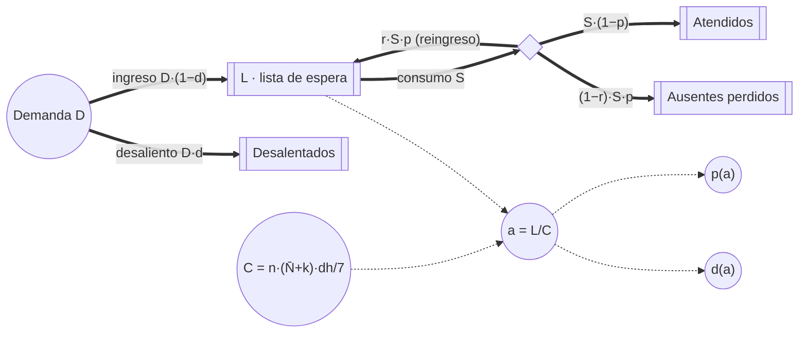

# Dinámica de sistemas (paso #5, Cap. 7)

> Diseño escrito antes de implementar. Código en `src/dinamica/` (TypeScript puro); pantalla en
> `#/dinamica`. El modelo del día, los presets y el estudio precalculado no se modifican: este
> módulo los usa como datos.

Hay dos modelos:

- **Parte A · Modelo fluido de la jornada** (minutos): la sala de espera como stock continuo. Sirve
  para contrastar el enfoque determinista del Cap. 7 con la simulación de eventos discretos del
  Cap. 3.
- **Parte B · Lista de espera** (semanas): el modelo principal. Describe cómo se forman la
  anticipación de los turnos y el ausentismo, y cómo responden a un pico de demanda con tres
  políticas de sobreturnos.

---

## Parte A · Modelo fluido de la jornada

Hay un stock por profesional, W_i(t), los pacientes esperando en la sala. La sala total es
W(t) = Σ W_i.

```
dW_i/dt = λ_i(t) − s_i(t)
s_i(t)  = μ_i(t)                 si W_i > 0
s_i(t)  = min(λ_i(t), μ_i(t))    si W_i = 0
```

**Entrada λ_i(t)** [pac/min]: los pacientes que pasan a la sala, con los mismos parámetros medios
que el modelo del día.

- **Turnos:** cada slot para turnos (no cupo) aporta (1 − p̄)·ocupación de paciente. Su hora de
  llegada a la sala es hora + desvío + admisión. Las distribuciones del desvío y del tiempo de
  admisión se representan por 200 y 20 cuantiles.
- **Sobreturnos:** 1 − p(1 día), en la ubicación esperada de su política. El fluido no puede
  representar `mayor_ausentismo`, que depende de la anticipación sorteada de cada slot, y lo trata
  como intercalado.
- **Espontáneos:** tasa por hora × peso de la especialidad, repartida entre los profesionales de
  la especialidad que admiten a esa hora. Los demás se pierden en la puerta, igual que en el modelo
  del día.

**Capacidad μ_i** [pac/min] = 1 / duración media de la consulta, ponderada entre turnos (0,925·D) y
espontáneos (0,8·D). Rige desde la llegada media del médico, inicio + E[demora] = inicio + 8,3 min,
y sigue después del fin del turno mientras haya stock.

**Integración:** Euler con dt = 0,25 min. Se compara contra la media de 500 días simulados con la
misma semilla del estudio (2026600), en el policonsultorio con política intercalada.

### Resultado

Eventos discretos con su IC 95 %:

| | Área en sala, fluido [pac·min/día] | Área en sala, eventos discretos | Espera por paciente, fluido [min] | Espera por paciente, eventos discretos | Máximo en sala, fluido | Máximo en sala, eventos discretos |
|---|---|---|---|---|---|---|
| k = 0 | 209,1 | 783,4 ± 28,0 | 3,41 | 12,63 ± 0,41 | 2,02 | 4,35 |
| k = 2 | 571,9 | 1231,4 ± 41,3 | 8,55 | 18,25 ± 0,57 | 2,16 | 5,71 |

El modelo fluido **subestima la espera 3,7 veces sin sobreturnos y 2,1 veces con k = 2**.

- Fuera de la apertura de cada turno predice cola cero, porque la capacidad media supera a la
  entrada media.
- En la simulación, la variabilidad de los tiempos de atención, la puntualidad y la demanda
  espontánea genera cola aunque la capacidad alcance (teoría de colas: la espera crece con la
  varianza, Pollaczek-Khinchine).
- Por eso las decisiones de sobreturnos no se pueden tomar con un modelo de medias: el costo de
  espera que equilibra al ocio aparece solo con la variabilidad.

---

## Parte B · Dinámica de sistemas de la lista de espera

### B.1 Diagrama causal

```mermaid
flowchart LR
  L([Lista de espera L]) -- "+" --> A[Anticipación a = L/C]
  C[Capacidad C] -- "−" --> A
  A -- "+" --> P[Ausentismo p]
  P -- "+" --> RE[Reingresos r·p·S]
  RE -- "+" --> L
  A -- "+" --> DS[Desaliento d]
  DS -- "−" --> DE[Demanda efectiva D·(1−d)]
  DE -- "+" --> L
  L -- "+" --> S[Consumo de turnos S]
  S -- "−" --> L
  K[Sobreturnos k] -- "+" --> C
  P -. "observado (semanal)" .-> K
```

**Bucles:**

- **R1 · Ausentismo que se realimenta (refuerzo):** L↑ → a↑ → p↑ → reingresos↑ → L↑. Cuanto más
  lejos queda el turno, más pacientes faltan; la mitad de ellos vuelve a pedir turno y alarga la
  lista.
- **B1 · Desaliento (balance):** L↑ → a↑ → desaliento↑ → demanda efectiva↓ → L↓. Cuando la espera
  supera un umbral, parte de los pacientes se atiende en otro lado.
- **B2 · Consumo (balance):** L↑ → S↑ (hasta la capacidad) → L↓.
- **B3 · Política adaptativa (balance, solo con k adaptativo):** p observado↑ → k↑ → C↑ → a↓ → p↓.

### B.2 Diagrama de Forrester



En la pantalla los dos diagramas están dibujados en SVG.

### B.3 Ecuaciones

El tiempo t está en días calendario. Los stocks y flujos se miden en pacientes y pacientes/día.

| Variable | Ecuación | Unidad |
|---|---|---|
| Capacidad | C(k) = n · (N̄ + k) · dh / 7 | turnos/día |
| Anticipación | a = L / C | días |
| Ausentismo | p̄(a) = Σ f_d · logist(β₀ + β₁ · d · a / ā) / Σ f_d, con ā la media de la tabla | — |
| Desaliento | d(a) = d_max · clamp((a − u) / w, 0, 1) | — |
| Demanda | D(t) = D₀ · (1 + 0,3 · 1{semana ∈ pico}) | pac/día |
| Consumo | S = min(C, L / τ) | turnos/día |
| Lista | dL/dt = D·(1 − d) + r·p·S − S | pac/día |
| Atendidos | dA/dt = S·(1 − p) | pac/día |
| Ausentes perdidos | dN/dt = (1 − r)·p·S | pac/día |
| Desalentados | dZ/dt = D·d | pac/día |
| Beneficio | dB/dt = B_E3(k, p) · (dh/7) · (S/C) | $/día |
| k adaptativo | al cierre de cada semana, k = argmax_k B_E3(k, p_observado), con p_observado = ausentes / consumo de esa semana | — |

**Conservación:** L + A + N + Z = L₀ + ∫D dt. Los reingresos vuelven a L y no se crean ni se pierden
pacientes.

**Equilibrio** con demanda constante D: dL/dt = 0, o sea D·(1 − d(a*)) = min(C, a*·C/τ)·(1 − r·p̄(a*)).
No tiene forma cerrada (por la logística); se resuelve por bisección con 200 iteraciones, y
L* = a*·C.

**Acople micro → macro:** B_E3(k, p) es el beneficio medio por día hábil del estudio precalculado
(E3: policonsultorio, política ganadora `mayor_ausentismo`, k = 0–6, ausentismo 5–30 %),
interpolado linealmente en p y recortado a [5 %, 30 %]. Es una tabla de consulta: no se vuelve a
simular el día.

### B.4 Parámetros

| Parámetro | Valor | Origen |
|---|---|---|
| n, profesionales | 3 | Preset policonsultorio |
| N̄, turnos reservables por profesional y día hábil | 19,33 | Preset: slots sin cupos × ocupación 1 |
| dh, días hábiles por semana | 5 | Supuesto SD1 |
| D₀, demanda base | 41,43 pac/día (= C(0)) | Supuesto SD3 |
| Pico | +30 % entre las semanas 10 y 16 | Mensaje #5 (invierno) |
| r, reingreso de ausentes | 0,5 | Supuesto SD4 |
| Desaliento: umbral u, ancho w, máximo d_max | 14 d, 14 d, 0,6 | Supuesto SD5 |
| τ, tiempo mínimo hasta el turno | 1 día | Supuesto SD6; mínimo de la tabla |
| β₀, β₁ y tabla de anticipación | −2,4973; 0,055; 1, 3, 7, 14, 21, 30 días | Modelo del día |
| Horizonte | 36 semanas | — |

### B.5 Supuestos

- **SD1.** El consultorio atiende 5 días por semana. La capacidad por día calendario es la de un
  día hábil × 5/7.
- **SD2.** La anticipación media es L/C (Ley de Little: tiempo en el sistema = stock / tasa de
  salida).
- **SD3.** La demanda base de turnos es igual a la capacidad sin sobreturnos: la agenda llena del
  modelo del día.
- **SD4.** La mitad de los ausentes vuelve a pedir turno; la otra mitad se pierde.
- **SD5.** El desaliento crece linealmente desde 0, con 14 días de anticipación, hasta el 60 % de la
  demanda, con 28 días.
- **SD6.** Nadie consigue turno antes de un día.
- **SD7.** El ausentismo con anticipación media a usa la misma logística del modelo del día sobre la
  tabla de anticipación reescalada a media a.
  - Con a = 11,95 días, la media de la tabla, reproduce el p̄ = 14,7 % del modelo del día.
  - Usar la logística en a directamente subestimaría p̄ por la desigualdad de Jensen
    (p(11,95) = 13,3 %).
- **SD8.** Todas las políticas arrancan del mismo estado, el equilibrio sin sobreturnos (el
  consultorio de hoy), y desde t = 0 aplican su k.
- **SD9.** El beneficio diario es el de la tabla de E3 escalado por la fracción de la agenda que se
  usa (S/C). La tabla supone agenda llena; con lista corta, S < C.
- **SD10.** Los sobreturnos suman capacidad de la lista igual que un turno. En el modelo del día se
  reservan con un día de anticipación; acá no se distingue.

### B.6 Validación (tests en `tests/dinamica/lista.test.ts`)

| Validación | Resultado |
|---|---|
| Ausentismo con a = ā | p̄(11,95) = 14,705 %, el del modelo del día |
| Equilibrio, k = 0 | a* = 16,165 días, L* = 669,674, p* = 18,55 %, d* = 9,3 %, saturado. La integración (RK4, dt = 0,25) desde 0,3·L* llega a 669,674 tras 120 semanas: diferencia < 10⁻⁹ |
| Equilibrio, k = 2 | a* = 0,944 días, L* = 43,15, p* = 7,98 %. Sin saturar: la capacidad supera a la demanda y la lista se vacía hasta el mínimo |
| Consistencia | a* = 16,2 días con la demanda base, dentro del rango de la tabla del modelo del día (1–30 días; media 11,95) |
| Conservación | Error < 10⁻⁷ pacientes, con Euler y RK4 y las tres políticas |
| Monotonía | Más demanda → L* mayor y L(t) mayor en toda la trayectoria (D × 0,95; 1; 1,05; 1,1) |

### B.7 Convergencia numérica

Escenario con pico, k = 2 fijo. Referencia: RK4 con dt = 0,01 (L_max = 859,464; L final = 604,738;
beneficio $275.094.460).

| Método | dt [días] | L máx. | Error L máx. | L final | Error L final | Error beneficio |
|---|---|---|---|---|---|---|
| Euler | 1 | 861,186 | 1,72 | 604,042 | 0,70 | $1.943 |
| Euler | 0,25 | 859,902 | 0,44 | 604,567 | 0,17 | $497 |
| Euler | 0,1 | 859,647 | 0,18 | 604,671 | 0,068 | $200 |
| RK4 | 1 | 858,168 | 1,30 | 604,628 | 0,11 | $56 |
| RK4 | 0,25 | 859,149 | 0,31 | 604,712 | 0,027 | $15 |
| RK4 | 0,1 | 859,346 | 0,12 | 604,728 | 0,010 | $6 |

- **Euler:** el error es proporcional a dt (orden 1): dividir dt por 4 divide el error por ~4.
- **RK4:** es 6–30 veces más preciso en L final y en el beneficio. En L máx. su ventaja es chica,
  porque el modelo no es suave: `min(C, L/τ)` y la rampa del desaliento tienen quiebres, y en ellos
  RK4 pierde su orden 4. Es una limitación conocida de los métodos de orden alto con funciones
  definidas por tramos.
- Con dt = 0,25 los dos métodos quedan por debajo de medio paciente sobre una lista de ~860, de
  sobra para el análisis. La pantalla usa RK4 con dt = 0,25 por defecto.

### B.8 Resultados: tres políticas durante el pico

Pico de +30 % entre las semanas 10 y 16. Los totales "pico" van de la semana 10 a la 22 (el pico y
las 6 semanas siguientes). RK4, dt = 0,25.

| Política | L máx. | a máx. [días] | p máx. | Atendidos (pico) | Perdidos (pico) | Beneficio (pico) | Beneficio (36 semanas) |
|---|---|---|---|---|---|---|---|
| Sin sobreturnos (k = 0) | 865,8 | 20,9 | 23,5 % | 2735 | 1227 | $86.243.874 | $262.180.473 |
| k fijo = 2 (recomendado del estudio) | 859,1 | 18,8 | 21,2 % | 3107 | 833 | $90.983.170 | $275.094.444 |
| k adaptativo (tabla de E3) | 836,3 | 17,5 | 19,9 % | 3300 | 579 | $91.949.194 | $277.224.175 |

**Política adaptativa:**

- **k semana a semana:** 3 3 3 3 3 2 3 2 2 2 2 2 3 3 3 3 4 3 3 3 3 3 3 3 3 3 2 3 2 2 2 2 2 2 2 2.
- **Comportamiento:** sube a 3 y 4 cuando el pico alarga la lista y el ausentismo observado pasa del
  17 % al 20 %. Vuelve a 2 cuando la lista se descomprime.
- **Frente a k fijo = 2:** pierde 30 % menos pacientes durante el pico (579 contra 833) y gana
  $966.000 más en el pico.
- **Frente a k = 0:** pierde menos de la mitad (579 contra 1227).
- **Mecanismo:**
  - dar sobreturnos acorta la lista, lo que baja la anticipación, el ausentismo y el desaliento (los
    bucles R1 y B1 trabajan a favor);
  - ajustar k al ausentismo observado agrega el bucle B3, que responde al pico antes de que la lista
    llegue al umbral de desaliento.
