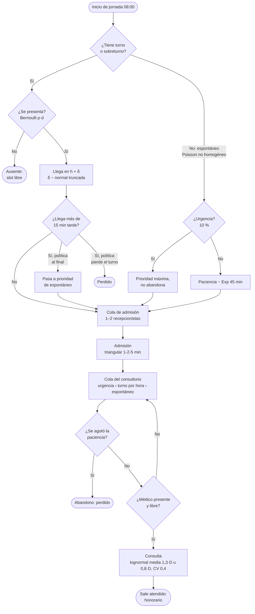
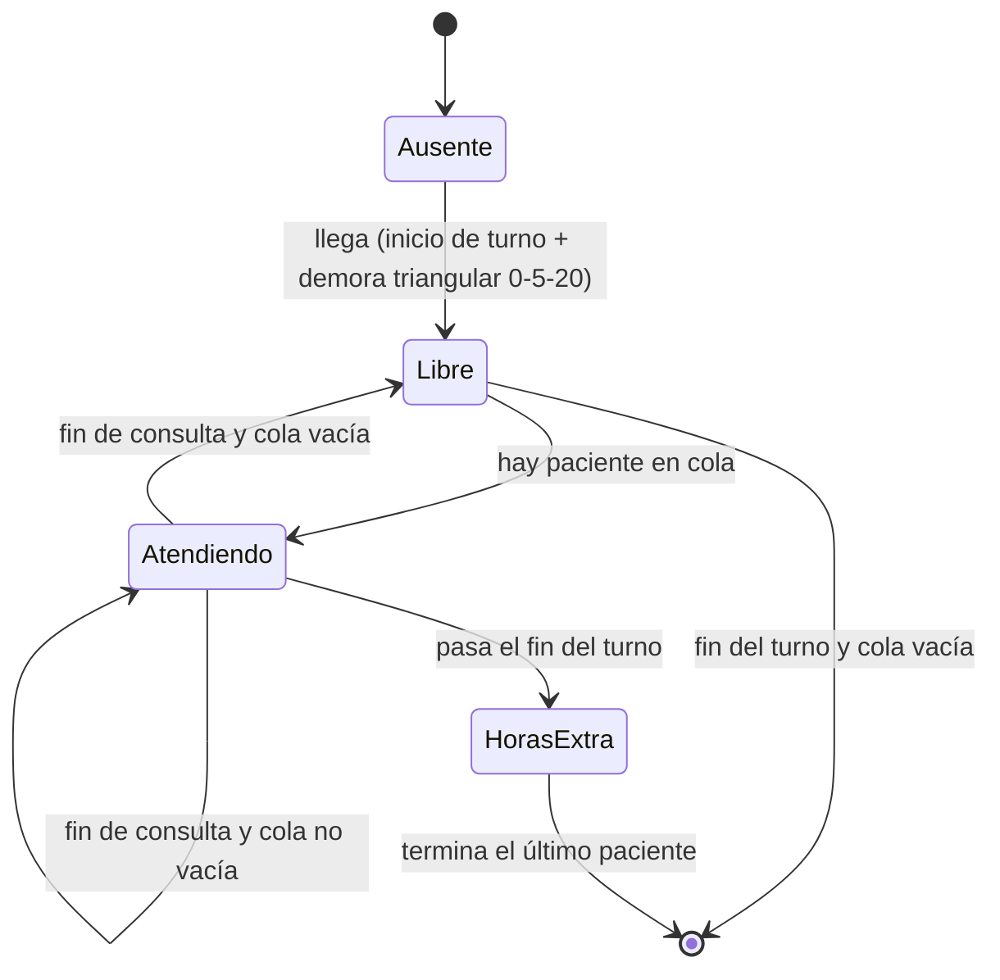

# Modelo conceptual — Sobreturnos en un policonsultorio

> Documento base para el informe. Describe **qué** se simula (paso #2 lo implementa).
> Todos los valores numéricos son **ficticios**, editables desde la aplicación y se
> marcan como supuestos (S*n*). Unidad de tiempo: minutos desde las 00:00.

## 1. Problema y pregunta de decisión

Un policonsultorio da turnos programados, pero una fracción de los pacientes no se
presenta (ausentismo). Para no desperdiciar horas médicas se dan **sobreturnos**: pacientes
adicionales sobre la agenda. Si se dan pocos, el médico queda ocioso; si se dan muchos o se
ubican mal, crecen las esperas, las horas extra y los pacientes que se van sin atención.

**Variables de decisión, por profesional:**

- `k`: cantidad de sobreturnos (0, 1, 2, …).
- Política de ubicación: **al inicio**, **al final**, **intercalados** o **en los horarios de
  mayor ausentismo** esperado.

**Objetivo:** elegir `k` y la ubicación que minimizan el costo esperado por día

```
CT = c_espera · Σ espera de pacientes  +  c_ocio · ocio del médico
   + c_extra · horas extra             +  c_perdido · pacientes no atendidos
```

y, como medida complementaria, el **resultado neto** = honorarios cobrados − CT.

## 2. Tipo de simulación y horizonte

- **Eventos discretos, terminante:** cada réplica es **un día** de 08:00 a 20:00 que arranca
  vacío (sin pacientes ni colas) y termina cuando se atiende al último paciente presente.
  No hay período de calentamiento: el transitorio de la mañana *es* parte de lo que se
  quiere medir. (El calentamiento del paso #1 solo se usó para validar el motor contra
  fórmulas de estado estacionario.)
- **Monte Carlo:** R réplicas independientes (días) por escenario, IC 95 % con t de Student.
  Los escenarios se comparan con **números aleatorios comunes**: la misma réplica usa los
  mismos números en cada fuente de aleatoriedad, así las diferencias se deben a la
  política y no al azar.
- **Línea en serie (Cap. 5):** admisión → consultorio.
- **Dinámica de sistemas (paso #5):** visión agregada de stocks y flujos (pacientes en
  espera, capacidad médica) sobre la misma jornada.

## 3. Entidades y atributos

| Entidad | Atributos |
|---|---|
| **Paciente** | `id`; `clase` ∈ {turno primera vez, turno control, sobreturno, espontáneo, urgencia}; profesional asignado; hora del turno `h` (si tiene); días de anticipación `d`; ¿se presenta?; desvío de puntualidad `δ`; hora de llegada; tiempo de atención; paciencia (espontáneos no urgentes); prioridad en cola; marcas de tiempo (llegada, inicio/fin admisión, inicio/fin consulta, abandono). |
| **Profesional** (1 a 6) | especialidad (clínica, pediatría, cardiología, traumatología, ginecología, dermatología); turno (mañana 08–14 o tarde 14–20); duración del turno de agenda `D` ∈ {15, 20, 30} min; demora al iniciar; estado (ausente, libre, atendiendo); hora real de llegada y de salida. |
| **Recepcionista** (1 a 2) | estado (libre, atendiendo). Forman un único recurso "admisión" de capacidad 1–2. |
| **Agenda** (por profesional) | lista de slots `h₀, h₀ + D, …` dentro del turno; cada slot con su paciente de turno y, si corresponde, un sobreturno superpuesto. |

## 4. Recursos y colas

| Recurso | Capacidad | Disciplina de la cola |
|---|---|---|
| Admisión | 1–2 recepcionistas | Prioridad: urgencias primero; el resto FIFO. |
| Consultorio de cada profesional | 1 (0 mientras el médico no llegó) | Prioridad: (1) urgencias; (2) pacientes con turno o sobreturno, por hora de turno; (3) espontáneos, FIFO. Los tardíos con política "al final" pasan a la clase (3). |

El motor ya ofrece estas disciplinas (`Recurso` con `FIFO` o `PRIORIDAD` + `orden`), el
abandono (`retirar`) y la capacidad variable (`cambiarCapacidad`, para la llegada tarde del
médico y el fin de su turno).

## 5. Eventos

| Evento | Qué cambia | Qué programa |
|---|---|---|
| **Inicio de jornada** (08:00) | Crea agendas, decide quién se presenta (ausentismo) y sus llegadas (puntualidad); genera las llegadas espontáneas del día (Poisson no homogéneo). | Llegadas, inicios de turno médico. |
| **Llegada del médico** (inicio de turno + demora) | Consultorio pasa de capacidad 0 a 1; si hay cola, empieza a atender. | Fin de consulta. |
| **Llegada de paciente** | Si es tardío (> 15 min) aplica la política: pierde el turno (perdido) o pasa al final. Entra a la cola de admisión. | Fin de admisión (si hay recepcionista libre); abandono (espontáneos no urgentes). |
| **Fin de admisión** | Libera recepcionista; el paciente entra a la cola del consultorio con su prioridad. | Siguiente admisión; fin de consulta (si el médico está libre). |
| **Abandono** (paciencia agotada) | El espontáneo sale de la cola sin ser atendido (perdido). Se cancela si empezó a atenderse antes. | — |
| **Fin de consulta** | Libera al médico; registra la espera y el honorario. | Siguiente consulta. |
| **Fin de turno del médico** (14:00 / 20:00) | Se cierran las llegadas espontáneas a ese profesional; el médico sigue hasta vaciar su cola (horas extra). | — |
| **Fin de jornada** | Cuando no quedan pacientes, se cierran las estadísticas del día. | — |

## 6. Variables de estado

- Reloj de simulación `t`.
- Por profesional: estado (ausente / libre / atendiendo), largo de su cola, paciente en
  atención.
- Admisión: recepcionistas ocupados, largo de la cola.
- Pacientes en el sistema (en admisión, esperando consultorio, en consulta).
- Acumuladores: espera total, tiempo ocioso, horas extra, pacientes atendidos, perdidos
  (por abandono, por tardanza, por cierre), honorarios.

## 7. Medidas de desempeño

Por réplica (día) y, entre réplicas, con media e IC 95 %:

- **Espera** de cada paciente: `inicio de consulta − max(llegada, hora del turno)` para
  pacientes con turno (no se cuenta la espera por llegar temprano, S12) e `inicio − llegada`
  para espontáneos. Se informa media, percentil 90 y máximo; también la espera en admisión.
- **Ocio del médico:** minutos dentro de su turno programado en que está presente y sin
  paciente.
- **Horas extra:** `max(0, fin de la última consulta − fin del turno)`.
- **Pacientes no atendidos:** abandonos + tardíos que pierden el turno + espontáneos
  rechazados por cierre. (Los ausentes no se cuentan: no vinieron.)
- **Utilización** del médico y de admisión; **L** y **Lq** ponderados por tiempo.
- **Costo total CT** y **resultado neto**.

## 8. Datos de entrada y distribuciones (todos ficticios)

| Fuente | Modelo | Parámetros (supuestos) |
|---|---|---|
| Demora del médico al iniciar | Triangular | min 0, moda 5, máx 20 min (S5) |
| Tipo de paciente con turno | Bernoulli | 40 % primera vez, 60 % control (S6) |
| Tiempo de atención | Lognormal (media, CV) | media 1,3·D (primera vez) u 0,8·D (control); CV 0,4 (S7) |
| Puntualidad `δ` (llegada − hora del turno) | Normal truncada | media −5 min, desvío 8, rango [−30, +30] (S8) |
| Anticipación del turno `d` | Discreta empírica | 1, 3, 7, 14, 21, 30 días con frecuencias 10, 15, 25, 25, 15, 10 (S9) |
| Ausentismo | Bernoulli con p logística | `p(d) = 1 / (1 + e^−(β₀ + β₁·d))`, β₀ = −2,4973, β₁ = 0,05500 (S10) |
| Llegadas espontáneas | Poisson no homogéneo (thinning) | perfil por hora de 08 a 20: 1,5 · 2,5 · 2 · 1,5 · 1 · 1 · 1 · 1,5 · 2 · 2 · 1,5 · 1 llegadas/h para todo el policonsultorio (Λ = 18,5/día) (S11) |
| Urgencia | Bernoulli | 10 % de los espontáneos |
| Paciencia (espontáneo no urgente) | Exponencial | media 45 min |
| Atención en admisión | Triangular | min 1, moda 2, máx 5 min |
| Honorario y costos | constantes | honorario $30 000/consulta; c_espera $150/min; c_ocio $500/min; c_extra $750/min; c_perdido $20 000/paciente (ARS, S14) |

**Calibración del ausentismo:** se impone `p(1) = 0,08` y `p(30) = 0,30`:
`logit(0,08) = −2,4423`, `logit(0,30) = −0,8473` ⇒ `β₁ = (−0,8473 + 2,4423)/29 = 0,05500`,
`β₀ = −2,4423 − β₁ = −2,4973`. Valores intermedios: `p(7) = 0,108`, `p(14) = 0,151`.
Fuera de [1, 30] días la logística extrapola (p(60) = 0,69), por eso la anticipación se
limita a ese rango.

## 9. Supuestos

- **S1.** Jornada 08:00–20:00; turno mañana 08–14 y tarde 14–20. Cada profesional atiende un solo turno por día.
- **S2.** Un consultorio por profesional; los profesionales no comparten pacientes con turno.
- **S3.** La agenda llena el turno: `360 / D` slots (24, 18 o 12) más `k` sobreturnos superpuestos a slots existentes según la política.
- **S4.** Políticas de ubicación: *al inicio* = los primeros `k` slots; *al final* = los últimos `k`; *intercalados* = slots equiespaciados `⌊i·n/(k+1)⌋`, i = 1..k; *mayor ausentismo* = los `k` slots cuyos pacientes tienen mayor `p(d)` (mayor anticipación).
- **S5.** El médico llega con una demora triangular(0, 5, 20) respecto del inicio de su turno y no se retira antes de terminar su cola.
- **S6.** 40 % de los turnos son de primera vez; los sobreturnos tienen la misma mezcla.
- **S7.** El tiempo de atención depende de la duración del turno de agenda (`D`) y del tipo de consulta; espontáneos y urgencias se atienden como "control" (0,8·D).
- **S8.** La puntualidad no depende del tipo de paciente. Tardío = llega más de 15 min después de su hora; la política es configurable: *se atiende al final* (pasa a la prioridad de los espontáneos) o *pierde el turno*.
- **S9.** Los turnos regulares se reservan con anticipación según la tabla; los sobreturnos se dan con 1 día de anticipación (ausentismo ≈ 8 %).
- **S10.** El ausentismo de cada paciente es independiente de los demás.
- **S11.** Los espontáneos eligen una especialidad con probabilidad proporcional a la cantidad de profesionales de esa especialidad en turno, y dentro de ella van al de menor cola. Si no hay ninguno en turno, no ingresan al sistema. Se aceptan hasta 30 min antes del fin del turno.
- **S12.** Un paciente con turno que llega temprano puede ser atendido antes de su hora si el médico está libre (configurable); la espera computable empieza en `max(llegada, hora del turno)`.
- **S13.** Todos los pacientes pasan por admisión; las urgencias tienen prioridad también allí y no abandonan.
- **S14.** Los costos y el honorario son constantes por minuto o por paciente; valores ficticios en ARS.
- **S15.** Los días son independientes e idénticamente distribuidos (no hay estacionalidad ni arrastre de pacientes entre días).

## 10. Flujo del paciente



Ciclo del médico:



## 11. Verificación y validación

- **Verificación (paso #1):** generador xoshiro128** contra su vector de referencia; cada
  distribución con media y varianza muestrales dentro del IC; motor de eventos con tests de
  orden, prioridad, abandono y capacidad variable.
- **Validación del motor (paso #1):** el mismo motor, configurado como M/M/1 y M/M/3,
  reproduce Erlang C (ρ, P(espera), L, Lq, W, Wq) y cumple la Ley de Little en cada réplica.
- **Validación del modelo (paso #2 en adelante):** casos límite con solución conocida
  (sin ausentismo ni variabilidad → agenda determinista; un solo médico con llegadas
  Poisson → M/G/1 con Pollaczek-Khinchine), análisis de sensibilidad y, si se consiguen,
  datos reales importados.

## 12. Puntos a definir en el paso #2

1. Si "al final" para los tardíos significa después del último turno del día o
   simplemente detrás de los turnos presentes (hoy: S8, prioridad de espontáneo).
2. Si la espera por demora del médico se imputa igual que el resto (hoy: sí).
3. Si los pacientes perdidos por tardanza se cuentan en `c_perdido` (hoy: sí).
4. Si los sobreturnos se superponen a un slot (dos pacientes citados a la misma hora) o se
   agregan como slots extra de duración cero (hoy: superpuestos, S3).
