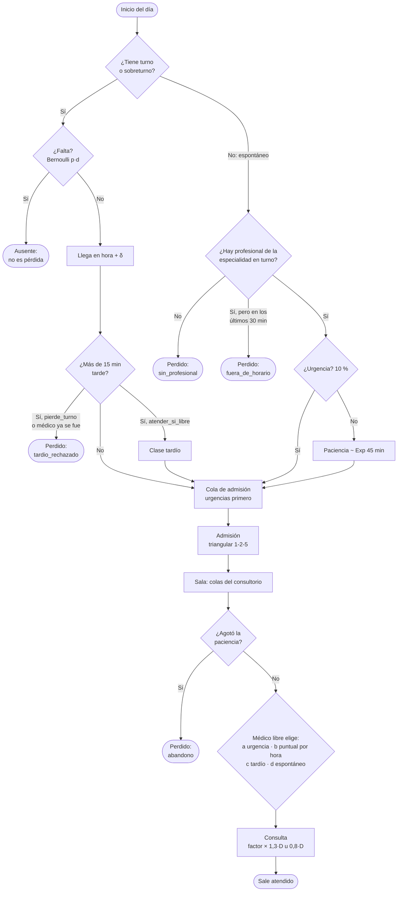
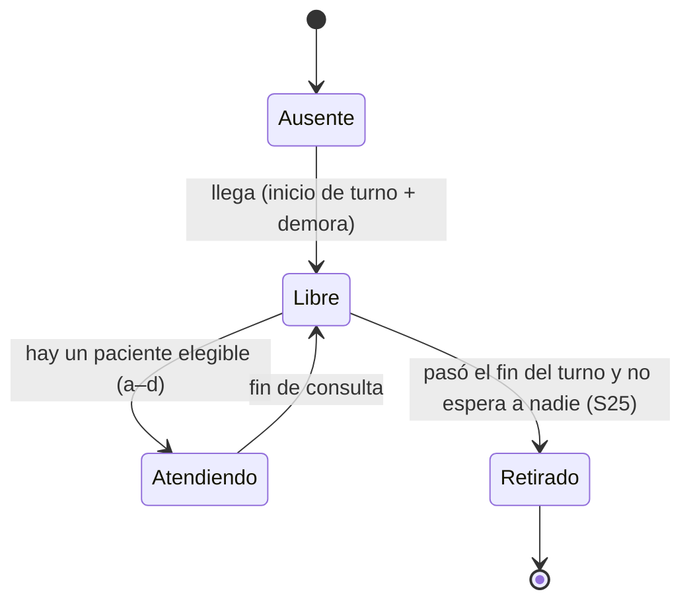

# Modelo conceptual — Sobreturnos en un policonsultorio

> Documento base para el informe. Describe **qué** se simula y con qué reglas; la
> implementación está en `src/modelo/` (paso #2). Todos los valores numéricos son
> **ficticios**, editables desde la aplicación y se marcan como supuestos (S*n*).
> Unidad de tiempo: minutos desde las 00:00.

## 1. Problema y pregunta de decisión

Un policonsultorio da turnos programados, pero una fracción de los pacientes no se
presenta (ausentismo). Para no desperdiciar horas médicas se dan **sobreturnos**: pacientes
adicionales sobre la agenda. Si se dan pocos, el médico queda ocioso; si se dan muchos o se
ubican mal, crecen las esperas, las horas extra y los pacientes que se van sin atención.

**Variables de decisión, por profesional:**

- `k`: cantidad de sobreturnos (0, 1, 2, …).
- Política de ubicación: `inicio`, `intercalado`, `mayor_ausentismo` o `final` (sección 5).

**Criterio PRINCIPAL — beneficio neto esperado por día** (se maximiza):

```
B = ingresos − c_espera · Σ espera de los atendidos − c_extra · horas extra − c_perdido · perdidos
    con ingresos = honorario × atendidos
```

El ocio **no se resta** en B: ya está reflejado en las consultas que no se facturan; restarlo
sería contarlo dos veces. Se sigue informando como indicador.

**Criterio SECUNDARIO — costo clásico de la bibliografía de agendamiento** (se minimiza):

```
C = c_espera · Σ espera + c_ocio · ocio + c_extra · horas extra + c_perdido · perdidos
```

con `c_ocio` **derivado** por defecto: el costo de oportunidad de cada profesional,
`c_ocio = honorario / duración media de sus consultas con turno = honorario / (D · (p·1,3 + (1 − p)·0,8))`
(con p = 0,25: D = 15 → $2.162/min; D = 20 → $1.622/min; D = 30 → $1.081/min).

**Equivalencia (aproximada).** Sumando, `C + B = ingresos + c_ocio · ocio = honorario × (atendidos + ocio / duración media)`:
el ingreso de las consultas hechas más el de las que se podrían haber hecho en el tiempo ocioso,
es decir, la capacidad del turno valuada a honorario. Si esa capacidad fuera fija, `C + B` sería
constante entre escenarios y maximizar B equivaldría a minimizar C. No es exacta porque (1) las
consultas hechas en **horas extra** agregan ingreso sin reducir el ocio, que solo se mide dentro
del turno; (2) las consultas que se ganan no duran exactamente la media (los espontáneos duran
0,8·D) y (3) cambian los abandonos. El barrido de control del #2c mide la diferencia
(`calibracion.md`, sección 8).

## 2. Tipo de simulación y horizonte

- **Eventos discretos, terminante:** cada réplica es **un día** que arranca vacío y termina
  cuando no queda ningún paciente ni médico en el edificio. No hay calentamiento: el
  transitorio de la mañana es parte de lo que se mide.
- **Monte Carlo (paso #4):** R réplicas independientes por escenario, IC 95 % con t de
  Student. Los escenarios se comparan con **números aleatorios comunes** gracias al
  pre-muestreo por identidad (sección 6).
- **Línea en serie (Cap. 5):** admisión → consultorio.
- **Dinámica de sistemas (paso #5):** visión agregada de la misma jornada.

## 3. Escenario (datos de entrada)

El escenario es un objeto JSON validado con zod (`src/modelo/escenario.ts`); es lo que se
importa y exporta. Contiene:

| Bloque | Contenido |
|---|---|
| `jornada` | inicio (08:00), cambio de turno (14:00), fin (20:00) |
| `profesionales` (1 a 6) | id, nombre, especialidad, turno (mañana/tarde), duración del turno de agenda `D` ∈ {15, 20, 30}, ocupación de la agenda, cupos de demanda espontánea `{cadaN}`, distribución de la demora al iniciar, sobreturnos `{k, política}` |
| `pacientes` | proporción de primera vez, tabla de anticipación (días), anticipación de los sobreturnos, atención (familia, CV y factores por clase) |
| `ausentismo` | β₀, β₁ de la logística |
| `puntualidad` | distribución del desvío, tolerancia, política de tardíos, ¿se adelantan turnos? |
| `espontaneos` | tasas por hora, mezcla por especialidad, % de urgencias, ¿abandonan?, paciencia, cierre antes del fin |
| `admision` | recepcionistas (1–2; 0 solo en validación), distribución del tiempo de atención |
| `costos` | c_espera, c_ocio (número o `'derivado'`), c_extra, c_perdido, honorario |

Los tiempos aleatorios se declaran como datos (`constante`, `uniforme`, `triangular`,
`exponencial`, `normal_truncada`, `lognormal`), así un mismo esquema sirve para el modelo
real y para los casos de validación.

**Presets** (`src/modelo/presets.ts`): *Consultorio chico* (1 clínico de mañana, 1
recepcionista, cupos 1 de cada 2 slots, demanda espontánea 1,6 × el perfil base y solo de 08 a
14), *Policonsultorio* (clínica mañana y tarde + pediatría mañana, 1 recepcionista, cupos 1 de
cada 3, demanda espontánea 2 × el perfil base; es el **escenario por defecto**) y *Centro
completo* (6 profesionales, 2 recepcionistas, cupos 1 de cada 12, demanda espontánea 1,5 × el
perfil base). Los tres parten de **k = 0** (situación inicial) y están calibrados para una
operación plausible: utilización 80–88 %, ausentismo 12–18 %, espera de turnos 5–15 min y menos de
20 min de horas extra por médico (ver [`calibracion.md`](calibracion.md); la meta de abandono
< 5 % no se alcanza, S31).

## 4. Entidades, atributos y recursos

| Entidad | Atributos |
|---|---|
| **Paciente** | identidad (`clave`); origen (turno, sobreturno, espontáneo); clase (turno, sobreturno, tardío, espontáneo, urgencia); profesional del turno; especialidad; hora del turno; anticipación y P(no-show) predicha; ¿falta?; ¿primera vez?; desvío de puntualidad; hora de llegada; tiempo de admisión; factor de atención; paciencia; marcas de tiempo. |
| **Profesional** | especialidad, turno, `D`, demora al iniciar, estado (ausente → libre ⇄ atendiendo → retirado), hora real de llegada y de salida, ocio, tiempo ocupado. |
| **Admisión** | recurso del motor con 1–2 recepcionistas y una cola con prioridad (urgencias primero, el resto FIFO). |

**Colas del consultorio:**

| Cola | Alcance | Orden |
|---|---|---|
| Urgencias | por especialidad (compartida) | FIFO |
| Puntuales (turno y sobreturno) | por profesional | hora del turno |
| Tardíos | por profesional | FIFO |
| Espontáneos | por especialidad (compartida) | FIFO |

## 5. Agenda y sobreturnos

- Cada profesional tiene `n = ⌊(fin − inicio) / D⌋` slots (24, 18 o 12 en un turno de 6 h).
- **Cupos de demanda espontánea** (`cuposEspontaneos.cadaN = N`): 1 de cada N slots,
  equiespaciados (slots `j` con `j mod N = ⌊N/2⌋`; con N = 3: slots 1, 4, 7, …). Un cupo nunca
  se reserva para un paciente con turno (S33).
- Cada slot para turnos (no cupo) está reservado con probabilidad `ocupaciónAgenda` (S16;
  1 = agenda llena).
- Sobreturnos (`k` por profesional), según la política. Los superpuestos solo van sobre slots
  para turnos, **nunca sobre cupos**; las fórmulas se aplican sobre la lista de esos `m` slots:
  - **inicio:** superpuestos a los primeros `k` slots (si `k > m`, se repite desde el primero);
  - **intercalado:** superpuestos a los slots `⌊i·m/(k+1)⌋`, i = 1..k (equiespaciados);
  - **mayor_ausentismo:** superpuestos a los `k` slots con mayor probabilidad de quedar
    vacíos: 1 si el slot no está reservado, si no la P(no-show) predicha por la anticipación
    conocida del turno (sobreturno informado). Empate: el slot más temprano (S17);
  - **final:** `k` turnos **extra** después del cierre de la agenda, a `fin, fin + D, …`.
- Los sobreturnos también pueden faltar: tienen 1 día de anticipación (P(no-show) ≈ 8 %).

## 6. Pre-muestreo de atributos (números aleatorios comunes)

Al generar el día, cada paciente sortea **todos** sus atributos desde un flujo aleatorio
propio cuyo nombre es su **identidad**, no el orden de los eventos:

- `P1/t/5`: slot 5 de la agenda de P1; `P1/s/0`: primer sobreturno de P1;
- `e/12`: espontáneo n.º 12 del día (los instantes de llegada salen de un flujo aparte);
- `P1/demora`: demora del médico P1.

De cada flujo se sacan siempre 10 uniformes en el mismo orden, se usen o no (S18):
u0 reservado · u1 anticipación · u2 falta · u3 primera vez · u4 puntualidad · u5 admisión ·
u6 atención · u7 paciencia · u8 urgencia · u9 especialidad.
Consecuencia (verificada por test): con la misma semilla, pasar de `k = 0` a `k = 3` no cambia
ningún atributo de ningún otro paciente, y el sobreturno *i* tiene los mismos atributos con
cualquier `k ≥ i + 1` (solo cambia su hora).

El tiempo de atención se pre-muestrea como un **factor de media 1** (lognormal con el CV del
escenario): duración = factor × factor de la clase × `D` del profesional que atiende (S19).
Así un espontáneo tiene el mismo factor lo atienda quien lo atienda.

## 7. Flujo del paciente y reglas

1. **Llegada.**
   - *Con turno o sobreturno:* llega en `hora + δ`. Si `llegada > hora + tolerancia`
     (15 min) es **tardío**: con `politicaTardios = "pierde_turno"` se pierde
     (`tardio_rechazado`); con `"atender_si_libre"` (por defecto) entra con clase tardío. Si
     su médico ya se retiró, también se pierde (`tardio_rechazado`).
   - *Espontáneo:* se decide en la puerta (S20). Entra si algún profesional de su
     especialidad está en turno y faltan más de 30 min para su fin. Si no, se pierde:
     `fuera_de_horario` si hay uno en turno pero en los últimos 30 min, `sin_profesional`
     si no hay ninguno en turno.
2. **Admisión** (si hay recepcionistas): cola con urgencias primero, atención triangular 1-2-5.
3. **Sala:** pasa a la cola que le corresponde (sección 4). Si `adelantarTurnos = false`, un
   puntual que terminó la admisión antes de su hora recién entra a la cola a su hora (S21).
4. **Selección del médico al quedar libre**, en este orden:
   (a) urgencias de su especialidad; (b) sus puntuales, por hora de turno; (c) sus tardíos;
   (d) espontáneos de su especialidad, por orden de llegada.
   (a) y (d) solo si es **responsable** de la especialidad: está en turno, o ya terminó y no
   hay otro profesional de la especialidad en turno (S22). Cuando llega un paciente a una cola
   compartida, se le ofrece primero al profesional libre hace más tiempo (S23).
   **Durante la ventana de un cupo** de demanda espontánea del profesional (el intervalo
   `[inicio + j·D, inicio + (j+1)·D)` de un slot cupo), el orden pasa a ser (a) urgencias,
   (d) espontáneos, (b) puntuales, (c) tardíos. Si no hay espontáneos esperando, rige el orden
   normal y el cupo no se desperdicia (S33).
5. **Abandono:** los espontáneos no urgentes abandonan cuando el tiempo desde su llegada
   supera la paciencia (lognormal, media 60 min, CV 0,5; configurable). En la cola de admisión o en la sala se
   van en el acto; durante la atención en admisión no, pero si al terminarla ya agotaron la
   paciencia y no los atiende un médico en ese instante, se van (S24). Las urgencias nunca
   abandonan.
6. **Consulta y salida.**
7. **Fin del turno del médico:** sigue atendiendo a sus pacientes presentes y espera a los
   que todavía pueden llegar puntuales (hasta `hora + tolerancia`, sin saber quién va a
   faltar). Si es responsable, también atiende urgencias y espontáneos de su especialidad
   ya admitidos. Se retira cuando no espera a nadie (S25). Todo lo que hace después del fin
   de su turno son **horas extra**.

## 8. Eventos

| Evento | Qué cambia | Qué programa |
|---|---|---|
| Inicio del día | Genera la agenda, los sobreturnos y los espontáneos con sus atributos. | Llegadas, llegada y fin de turno de cada médico, cierre de la ventana de puntualidad de cada turno. |
| Llegada del médico | Pasa de ausente a libre y toma la cola. | Fin de consulta. |
| Llegada de paciente | Rechazo, tardío o ingreso; entra a la cola de admisión. | Fin de admisión, abandono. |
| Fin de admisión | Libera al recepcionista; el paciente pasa a la sala. | Siguiente admisión, fin de consulta. |
| Abandono | El espontáneo sale sin ser atendido. Se cancela si empezó la consulta. | — |
| Fin de consulta | Libera al médico; el paciente sale. | Siguiente consulta o retiro. |
| Cierre de la ventana de puntualidad (hora + 15) | Si el paciente faltó, queda como ausente; el médico revisa si puede irse. | — |
| Fin de turno | Cambia quién es responsable de las colas compartidas. | — |

## 9. Variables de estado

Reloj; estado de cada médico; colas de urgencias y espontáneos por especialidad; colas de
puntuales y tardíos por médico; recepcionistas ocupados y cola de admisión; pacientes en
admisión, en sala y en consulta; acumuladores de ocio, tiempo ocupado y marcas de tiempo.

## 10. Medidas de desempeño (por día, por profesional y totales)

- **Espera** de cada atendido = `max(0, inicio de consulta − max(llegada, hora del turno))`
  para pacientes con turno (incluye admisión y la demora del médico; si se lo adelanta, 0) e
  `inicio − llegada` para espontáneos y urgencias. Media y P90 (interpolación lineal) por
  clase: turno, sobreturno, tardío, espontáneo, urgencia.
- **Espera en admisión** (cola, aparte) y **espera en sala** (`inicio − fin de admisión`).
- **Ocio:** minutos dentro del turno, con el médico presente y sin paciente disponible
  (desde su llegada real hasta el fin de su turno).
- **Horas extra:** `max(0, salida − fin del turno)`.
- **Utilización:** médico = tiempo atendiendo / tiempo presente; admisión = tiempo de
  atención / (recepcionistas × duración del día).
- **Atendidos por clase, ausentes** (no-show, **no** son pérdidas) y **perdidos por motivo**:
  `tardio_rechazado`, `abandono`, `fuera_de_horario`, `sin_profesional`.
- **Beneficio neto B** (criterio principal) e **ingresos**; **costo clásico C** (criterio
  secundario) por componente: espera de los atendidos, ocio (con el `c_ocio` de cada
  profesional), extra y perdidos (S26, S34). Por profesional, B y C cuentan solo sus pérdidas
  propias (tardíos rechazados); en el total entran todas.
- **Serie temporal** cada 5 min de pacientes en admisión, en sala y en consulta.
- **Ley de Little del día:** `L = ∫N(t)dt / T`, `λ = n / T`, `W = Σ permanencias / n`.

## 11. Datos de entrada (todos ficticios)

| Fuente | Modelo | Parámetros |
|---|---|---|
| Demora del médico al iniciar | Triangular | 0 – 5 – 20 min (S5) |
| Tipo de paciente con turno | Bernoulli | 25 % primera vez (S6; era 40 % antes de la calibración) |
| Tiempo de atención | factor lognormal (media 1, CV 0,4) × factor × D | 1,3 (primera vez), 0,8 (control, espontáneo, urgencia) (S7) |
| Puntualidad `δ` | Normal truncada | media −5, desvío 8, [−30, +30] (S8) |
| Anticipación del turno | Discreta empírica | 1, 3, 7, 14, 21, 30 días; frecuencias 10, 15, 25, 25, 15, 10 (S9) |
| Ausentismo | Bernoulli, p logística | β₀ = −2,4973, β₁ = 0,05500 (S10) |
| Espontáneos | Poisson no homogéneo (thinning) | 1,5 · 2,5 · 2 · 1,5 · 1 · 1 · 1 · 1,5 · 2 · 2 · 1,5 · 1 llegadas/h de 08 a 20 (Λ = 18,5) (S11) |
| Mezcla de espontáneos | Discreta, renormalizada sobre las especialidades presentes | clínica 55, pediatría 25, traumatología 10, cardiología 5, ginecología 3, dermatología 2 (S27) |
| Urgencias | Bernoulli | 10 % de los espontáneos |
| Paciencia | Lognormal (configurable: lognormal o exponencial) | media 60 min, CV 0,5: P(< 20 min) ≈ 1,8 %, P(< 30 min) ≈ 11 % (antes exponencial de media 45: P(< 5 min) = 10,5 %) (S24) |
| Admisión | Triangular | 1 – 2 – 5 min |
| Costos | constantes (ARS) | honorario 30 000; c_espera 150/min; c_extra 750/min; c_perdido 20 000; c_ocio derivado = honorario / duración media (D = 15 → 2 162/min, D = 20 → 1 622/min, D = 30 → 1 081/min; antes 500/min fijo) (S14, S34) |
| Cupos de demanda espontánea | 1 de cada N slots | chico N = 2, policonsultorio N = 3, centro N = 12 (S33) |

**Calibración del ausentismo:** `p(1) = 0,08` y `p(30) = 0,30` ⇒ `β₁ = 0,05500`, `β₀ = −2,4973`
(p(7) = 0,108; p(14) = 0,151). Fuera de [1, 30] días la logística extrapola (p(60) = 0,69),
por eso la anticipación se limita a ese rango.

## 12. Supuestos

- **S1.** Jornada 08:00–20:00; turno mañana 08–14 y tarde 14–20. Cada profesional atiende un solo turno por día.
- **S2.** Un consultorio por profesional; los pacientes con turno solo los atiende su profesional.
- **S3.** La agenda tiene `n = ⌊6 h / D⌋` slots; los sobreturnos se superponen a slots (o se agregan al final, política `final`).
- **S4.** Las cuatro políticas de ubicación son las de la sección 5.
- **S5.** El médico llega con una demora triangular(0, 5, 20) y no se retira antes de terminar lo que le corresponde (S25).
- **S6.** 25 % de los turnos son de primera vez (calibrado; antes 40 %), así la atención media es 0,925·D; los sobreturnos tienen la misma mezcla.
- **S7.** Espontáneos y urgencias se atienden con la media de un control (0,8·D del médico que los atiende).
- **S8.** La puntualidad no depende del tipo de paciente.
- **S9.** Los turnos regulares se reservan con la anticipación de la tabla; los sobreturnos, con 1 día.
- **S10.** El ausentismo de cada paciente es independiente de los demás.
- **S11.** La demanda espontánea es un Poisson no homogéneo con tasa constante por hora.
- **S12.** Si un paciente con turno es atendido antes de su hora (se adelanta), su espera es 0.
- **S13.** Todos los pacientes que entran pasan por admisión; las urgencias tienen prioridad también allí.
- **S14.** Costos y honorario constantes por minuto o por paciente, en ARS ficticios.
- **S15.** Los días son independientes e idénticamente distribuidos.
- **S16.** Cada slot para turnos (no cupo) está reservado con probabilidad `ocupaciónAgenda`, independiente de los demás (por defecto 1).
- **S17.** En `mayor_ausentismo` un slot para turnos libre cuenta con P(vacío) = 1, así que se llena antes que uno reservado; los cupos nunca son candidatos.
- **S18.** Cada paciente consume siempre 10 uniformes de su flujo, en un orden fijo.
- **S19.** El tiempo de atención es un factor de media 1 pre-muestreado por paciente, escalado por la clase y la `D` del médico que atiende.
- **S20.** La admisión de espontáneos se decide en la puerta, antes de la admisión administrativa; los rechazados no usan recepcionista.
- **S21.** Con `adelantarTurnos = false`, el puntual espera en la sala hasta su hora sin estar en la cola.
- **S22.** Un profesional que terminó su turno solo toma urgencias y espontáneos de su especialidad si no queda otro de la misma especialidad en turno.
- **S23.** Entre varios profesionales libres de la especialidad, toma al paciente de la cola compartida el que está libre hace más tiempo (empate: el de menor índice).
- **S24.** La paciencia es lognormal (media 60 min, CV 0,5): casi nadie se va en los primeros minutos (P(< 20) ≈ 1,8 %). Reemplaza a la exponencial de media 45 del #2, que por no tener memoria hacía que el 10,5 % se fuera en los primeros 5 min, algo inverosímil en una sala de espera. El reloj corre desde la llegada; durante la atención en admisión no se puede abandonar.
- **S25.** Después del fin de su turno, el médico espera a cada paciente propio hasta `hora + tolerancia` (no sabe quién falta) y, si es responsable, a los espontáneos de su especialidad que estén en admisión.
- **S26.** El costo de espera se cobra solo sobre los atendidos. La espera de los que abandonan no se cobra porque esos pacientes ya pagan `c_perdido`: cobrarles también la espera contaría dos veces la misma pérdida.
- **S27.** La mezcla de especialidades de los espontáneos es fija para todo el día y se renormaliza sobre las especialidades presentes en el escenario (un espontáneo solo pide lo que el policonsultorio ofrece). `sin_profesional` ocurre solo si la especialidad existe pero nadie de ella está en turno a esa hora. Si ninguna especialidad presente tiene peso, se reparte en partes iguales.
- **S28.** La admisión atiende desde la primera llegada del día (no tiene horario de apertura).
- **S29.** Solo para validación: 0 recepcionistas = sin admisión; β₀ = −50 equivale a ausentismo nulo (p ≈ 2·10⁻²²).
- **S30.** La situación inicial de los presets no tiene sobreturnos (`k = 0`): son la variable de decisión. El consultorio chico abre solo de mañana, así que no tiene demanda espontánea de 14 a 20.
- **S31.** Aun con cupos y paciencia lognormal, un espontáneo que llega fuera de la ventana de un cupo espera a la próxima ventana o a un hueco de la agenda: el abandono de la situación inicial queda en ≈ 15 % (chico), 19 % (policonsultorio) y 32 % (centro). La meta de calibración (< 5 %) no se alcanza con las palancas permitidas (ver `calibracion.md`, secciones 5 y 7).
- **S32.** Las urgencias tienen prioridad en las colas, pero no interrumpen una consulta en curso: esperan a que el médico de su especialidad quede libre (con la cola de la lognormal, una consulta larga puede demorarlas bastante).
- **S33.** Cupos de demanda espontánea: 1 de cada N slots por profesional (equiespaciados, `j mod N = ⌊N/2⌋`). No se reservan para turnos ni reciben sobreturnos superpuestos. Durante su ventana, el orden de selección es (a) urgencias, (d) espontáneos, (b) puntuales, (c) tardíos; si no hay espontáneos esperando, rige el orden normal. Fuera de las ventanas de cupo la regla no cambia.
- **S34.** El costo de ocio es el costo de oportunidad de cada profesional (`honorario / duración media de sus consultas con turno`), no un valor fijo: el $500/min del #2 subvaluaba el ocio frente a lo que genera un minuto de consulta (≈ $2.160/min con D = 15). Solo entra en el costo clásico C; el criterio principal es el beneficio B.

## 13. Flujo del paciente



Ciclo del médico:



## 14. Verificación y validación

**Paso #1 (motor):** generador contra su vector de referencia; distribuciones con media y
varianza en el IC; M/M/1 y M/M/3 contra Erlang C y Ley de Little por réplica. Criterio de
aprobación: IC simultáneo al 95 % conjunto (Bonferroni), informando también el individual.

**Limitación observada:** en M/M/1 con ρ = 0,9 la cobertura del IC fue 17/20 y solo 40 % de
los desvíos fueron positivos, compatible con un leve sesgo hacia abajo por arrancar con el
sistema vacío. Cuanto más cargado está el sistema, más largo tiene que ser el calentamiento
(el tiempo de relajación crece como 1/(1 − √ρ)²). Esto no afecta al modelo del consultorio,
que es terminante.

**Paso #2 (modelo), suite `tests/modelo/`:**

- (a) **Determinista:** sin ausentismo, puntualidad 0, demora 0, sin espontáneos, agenda llena
  y atención = D ⇒ cada consulta empieza exactamente a su hora, espera 0, ocio 0, horas extra 0
  (también con admisión constante de 3 min y llegada 5 min antes).
- (b) **M/G/1:** un profesional, solo espontáneos Poisson, atención lognormal, sin admisión
  ni abandono ⇒ Wq contra Pollaczek-Khinchine.
- (c) **Red en serie:** admisión M/M/1 → consultorios M/M/3 con cola compartida; por Burke la
  salida de la admisión es Poisson ⇒ cada espera coincide con su fórmula y la espera total con
  la suma (red de Jackson).
- (d) **Conservación:** generados = atendidos + perdidos + ausentes, sin pacientes ni eventos
  pendientes ni médicos sin retirarse; Little del día exacta.
- (e) **Casos límite:** k = 0; 100 % de ausentismo (ocio = turno completo); 1 y 6
  profesionales; paciencia 0; sin espontáneos; política `final` con k creciente (horas extra
  crecientes).
- **Reglas** con días armados a mano (orden a–d, tardíos, rechazos, traspaso entre turnos,
  espera hasta la tolerancia, adelanto de turnos) y **pre-muestreo** (k = 0 contra k = 3).
